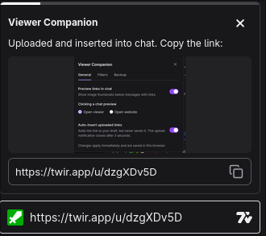
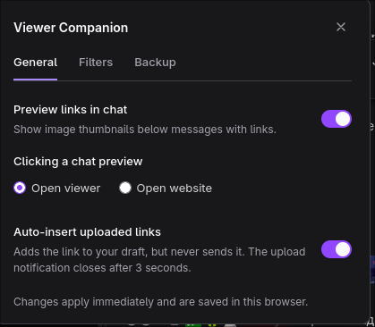

  

<h1 align="center">Viewer Companion</h1>

  <strong>Share, preview, and edit images without leaving the stream.</strong> 
  A viewer companion for Twitch and Kick. Formerly ImageUploader.

  
  

  
  
  

  <a href="#installation">Installation</a> ·
  <a href="#usage">Usage</a> ·
  <a href="#settings">Settings</a> ·
  <a href="#image-editor">Image editor</a> ·
  <a href="#api-and-privacy">Privacy</a>

---

**Viewer Companion** adds image-sharing and viewing tools to **twitch.tv** and **kick.com**, including subdomains. Use the Firefox extension or a Tampermonkey / Violentmonkey userscript; a standalone Chrome extension is **work in progress**.

- **Clipboard uploads** — paste an image, copy its public link, and choose when to send it.
- **Chat previews** — see inline image thumbnails, with filters for usernames, domains, and bots.
- **Image viewer** — open chat images full-screen, zoom up to 800%, and pan without leaving the page.
- **Local image editor** — crop, draw, rotate, or flip an uploaded image, then upload the edited version.

Uploads go to [Twir Uploader](https://twir.app/uploader), anonymously by default or to your connected Twir account in the browser extension. Links appear above the chat input, with a floating notification for unrecognized layouts. Automatic link insertion is off by default. **Viewer Companion never sends chat messages for you.**

> [!IMPORTANT]
> Pasting an image immediately uploads it to Twir, where it becomes accessible via a **public link**. Do not paste confidential images. Closing the panel does not delete the upload. See [API and privacy](#api-and-privacy).

## Installation

### Firefox — Mozilla Add-ons

1. Open [Viewer Companion on Mozilla Add-ons](https://addons.mozilla.org/en-US/firefox/addon/viewer-companion/) in Firefox.
2. Click **Add to Firefox** and confirm the installation and requested permissions.
3. Reload any open **Twitch** or **Kick** tabs.

Firefox handles extension updates through Mozilla Add-ons when automatic updates are enabled. Website access is needed to load image previews from links in chat; the extension itself runs only on Twitch and Kick.

### Tampermonkey / Violentmonkey

1. Install one userscript manager for your browser: [Tampermonkey](https://www.tampermonkey.net/) or [Violentmonkey](https://violentmonkey.github.io/get-it/).
2. Open [the latest Viewer Companion userscript](https://github.com/infybtw/viewer-companion/releases/latest/download/imageuploader.user.js).
3. In the userscript manager's installation page, click **Install** and make sure the script is enabled.
4. Allow connections to **twir.app** for uploads and to linked websites for image previews if prompted.
5. Reload any open **Twitch** or **Kick** tabs.

If the link downloads a file instead of opening an installation page, open your userscript manager's dashboard and import the downloaded `imageuploader.user.js` file. On Chrome, follow the manager's prompt to allow userscripts; see [Tampermonkey's instructions](https://www.tampermonkey.net/faq.php?q=Q209) if scripts do not run.

Keep automatic update checks enabled in your userscript manager to receive new stable versions from GitHub Releases. The `imageuploader.user.js` filename is kept for compatibility with existing installations.

### Chrome / Chromium — WIP

Chrome Web Store installation is **work in progress**. For now, use the **Tampermonkey / Violentmonkey** instructions above in Chrome or Chromium.

> [!NOTE]
> Use either the Viewer Companion extension or the userscript, **not both at once**. If you switch to the Firefox extension, disable the userscript to avoid duplicate uploads and previews.

## Usage

1. Copy an image, focus a chat input, and press **Ctrl+V** (**Cmd+V** on macOS).
2. Wait for the panel above the Twitch or Kick chat input and click the copy button to the right of the link.
3. Paste the link into chat and send the message yourself.

<strong>Paste behavior, upload panels, and copying links</strong>

Context-menu paste and other system paste shortcuts also work: the extension handles the `paste` event. Normal text pastes are unchanged. Password fields, disabled inputs, and pastes outside an editor are ignored.

The panel stays visible until you close it or successfully copy a link. It is embedded in Twitch and Kick without covering chat messages, uses the site's theme colors, and reattaches if the site replaces the chat input. If the chat input disappears or its layout is not recognized, a floating notification keeps the links available. Chat content and caret position are unchanged; the clipboard is overwritten only when you click the copy button. After a successful copy, the panel shows a three-second countdown and closes; copying again restarts the countdown. With automatic insertion enabled and successful, the uploaded link is added to the unsent chat message and the panel closes after three seconds. The Morphicons/Lucide icon morphs into a green checkmark and changes back after 2 seconds. The animation respects reduced-motion preferences.

Each uploaded link also has a clickable image preview above its copy row, in both the inline panel and floating notification. Clicking an upload thumbnail opens a full-screen image editor overlay; failed previews disappear without affecting the link or copy button. Multiple uploads scroll within the panel.

## Settings

Click the **VC** button next to the account controls in the Twitch top navigation or next to **Get KICKs** in the Kick header. The panel has **General**, **Filters**, **Accounts**, and **Backup** tabs.

<strong>General — previews and automatic link insertion</strong>

- **Preview links in chat** — show thumbnails below chat messages. Turning it off removes existing previews and stops image/metadata requests for chat links.
- **Clicking a chat preview** — **Open viewer** (default) enlarges the image on the page; **Open website** keeps the normal link behavior and opens the linked page in a new tab. Modifier-clicks always retain normal link behavior.
- **Auto-insert uploaded links** — after a successful upload, add the link to the unsent chat message at the caret where you pasted. When insertion succeeds, the upload panel closes after a three-second countdown. This is off by default and never sends the message. If the draft changed, a different field has focus, or the page navigated during the upload, the link is not inserted and the panel stays open.

<strong>Filters — usernames, domains, and bots</strong>

- **Excluded usernames** — enter usernames on separate lines or separated by commas. Matching ignores case and accepts an optional `@`. Only previews are hidden; message text and links stay visible.
- **Excluded domains** — enter domains (or full URLs) on separate lines or separated by commas. `example.com` also excludes `cdn.example.com`, but not `notexample.com`. The original link and any resolved metadata thumbnail are checked. Excluded original links are skipped before image/metadata requests; a blocked thumbnail discovered in metadata is not loaded. Redirect destinations not exposed by the browser are not a network blocklist.
- **Hide previews from bots** — on by default, covering known accounts such as Nightbot, StreamElements, Streamlabs, Moobot, Fossabot, Wizebot and BotRix, plus explicit bot badges such as Twitch's **Chat Bot** badge. Turn it off to show bot previews. It does not guess from names ending in `bot`; add unrecognized/custom bots to the username list. Bot detection uses rendered chat data locally, without external API calls.

Exclusions save automatically and apply to existing and new messages without reloading the page. Empty lists exclude nothing. These filters affect chat thumbnails only, not your upload panel or image editor.

<strong>Accounts — optional Twir sign-in (extensions only)</strong>

Under **Accounts**, **Sign in** opens Twir's sign-in and consent window. This is optional and available only in the Chrome/Firefox extension; the userscript explains that account sign-in is unavailable and continues uploading anonymously. Once connected, new uploads, including edited images, are associated with your Twir account. Images are still public by link. Twir currently bundles upload and deletion rights in `files:edit`; Viewer Companion requests only that scope and does not delete files. No profile, chat, moderation, or dashboard permissions are requested.

The extension remembers the connection across browser restarts. If Twir rejects the connection, uploads stop and **Reconnect Twir** becomes available; there is no silent anonymous fallback. Uploads also pause while sign-in is pending. **Cancel sign-in** invalidates the pending callback (you can close the Twir window). **Disconnect** clears local authorization and attempts to revoke both tokens at Twir. If revocation cannot be confirmed, the panel explains how to finish revoking access in Twir. Disconnecting does not delete images or undo an upload already in flight.

<strong>Backup — export and import settings</strong>

Under **Backup**, **Export settings** downloads a JSON file containing all six settings, including the exclusion lists. **Import settings** accepts a file created by that export, shows a summary, and replaces every current setting only after you choose **Replace settings**. The backup contains no chats, drafts, uploads, OAuth clients, or tokens. Importing does not change your account connection or send anything off the device. Backups made by ImageUploader remain compatible.

Settings are shared across Twitch and Kick by the extension. The userscript stores them in your userscript manager's storage, which is also shared across sites; if that storage is unavailable it falls back to the current site's local storage. No setting is uploaded anywhere.

## Image editor

Click your uploaded image's preview to edit it without leaving the site. Select **Crop**, drag a rectangle, then use **Apply** or **Cancel** directly below the selection. Cancel removes only the crop selection, keeping other edits. **Draw** provides a brush with color and size controls. You can also rotate, flip horizontally, use the animated **Undo / Redo** icons (Ctrl/Cmd+Z, Ctrl/Cmd+Shift+Z), or **Reset** to the image you opened. Icon animations respect reduced-motion preferences. Close with **Escape** or **×** to discard edits without uploading.

Edits use the local original, not the remote thumbnail. **Upload edited image** exports a PNG and uploads it through the same uploader, replacing only that image's link and preview after success. The old public upload is not deleted. Failed uploads keep the editor and edits available for retry. Opening the updated preview lets you edit the new version again. Editing is limited to 32 megapixels; animated GIFs become still PNGs. Edits are kept only in memory, and closing the editor discards unsaved work.

Multiple images upload sequentially. Failed uploads are not retried automatically; completed links remain available if a later upload fails.

## Image previews in chat

Both the extension and userscript show clickable thumbnails below messages containing HTTP/HTTPS links that return images in Twitch and Kick chat, not just Twir Uploader links. No image file extension is required; redirects to images also work. On Twitch, links to Twitch pages are left alone because Twitch already renders its own link cards. If a link does not load as an image, its HTML is checked for Open Graph or Twitter image metadata (`og:image`, `og:image:secure_url`, `og:image:url`, `twitter:image`, or `twitter:image:src`). This works across websites, including PicDrisnya posts, without a domain allowlist. This is a local feature: other viewers need the extension or userscript to see previews. Original message links stay unchanged.

<strong>Metadata requests, compatibility, and chat scrolling</strong>

Metadata is fetched anonymously without a referrer, following redirects, with an eight-second timeout and a 512 KiB HTML size limit. Relative image URLs are resolved against the final page URL (or its HTML base URL). Successful and failed metadata lookups are cached locally in memory to avoid repeated requests. By default, clicking a thumbnail opens the resolved image in the on-page viewer, not the linked website. The gear menu can switch clicks to normal website navigation, and can disable chat previews entirely. Page scripts are never executed: pages that supply metadata only after running JavaScript, require authentication, or block requests may not produce previews. The extension needs HTTP/HTTPS host permissions and the userscript needs `@connect *`; content scripts still run only on Twitch/Kick.

Previews work for existing and newly arriving messages, including after chat navigation/remounting. Each thumbnail is loaded off-screen first and inserted only when the image is ready, so the chat never flashes a broken placeholder; one preview is shown per unique URL with no per-message limit. Pages without image metadata, failed or deleted images, and images blocked by the site's security policy leave only the original link. Unrecognized chat layouts are left unchanged.

When chat is at or near the bottom, autoscroll includes the height of previews, including late metadata thumbnails. Scrolling up to read earlier messages keeps your position instead of pulling you back down.

## Large image viewer

Click any thumbnail in chat to view the image centered over a darkened, blurred backdrop without leaving the site. The image initially fits the available space. The same viewer is included in both browser extensions and the userscript. Your own upload-panel thumbnails open the image editor instead.

- Zoom with the mouse wheel, a two-finger pinch, the **+ / −** buttons, or the **+ / −** keys, up to **800%**. Wheel and pinch zoom follow the pointer/gesture position.
- Drag an enlarged image to pan; arrow keys also pan, and **Shift + arrow** moves farther.
- **Fit** or **0 / Home** resets the view; **1:1** or **1** shows actual size. Double-click toggles between fitted and enlarged views.
- Close with **Escape**, the **×** button, or a click on the empty backdrop. Dragging does not close the viewer.

Only one viewer opens at a time. It locks background scrolling, keeps keyboard focus inside, restores focus when closed, and refits to viewport changes. Failed full-size loads show an error without navigating away. Original message links, modifier-clicks, and link context menus retain their usual behavior. For metadata previews, the viewer displays the image provided by the page; a small `og:image` thumbnail cannot be reconstructed into a higher-resolution original.

## API and privacy

- Uploads use `POST https://twir.app/api/v1/uploader/files`, `multipart/form-data`, field `file`, and read the result from `data.link`.
- Supported: PNG, JPEG, GIF, WebP, AVIF, and BMP, up to **25 MiB** per file. SVG is not supported.
- Extension requests run in its background context with `credentials: "omit"`; a connected account adds a bearer token only to Twir uploads. Userscript requests run through the userscript manager with `anonymous: true` and never use Twir tokens. Neither uploads from the Twitch/Kick page context or uses Twir cookies, even if you are signed in elsewhere. Twir's own sign-in window uses its normal website login.
- The extension timeout is **60 seconds in Firefox**, **25 seconds in Chrome**; the userscript timeout is **60 seconds**. Interrupted uploads report an error without automatic retries. Twir controls API availability and upload limits.

Pasting an image **immediately uploads it to the third-party service Twir**, where it becomes accessible via a public link. Do not paste confidential images. Closing a notification or undoing chat text does not delete the upload. Retention/deletion policies belong to [Twir](https://twir.app/privacy); anonymous upload management is not implemented.

Both versions read images only from a trusted paste event in an editable field. They do not poll the clipboard, read browsing history, or store uploads. Filenames become `pasted-image.<format>`; image bytes and metadata are unchanged. Cookies, page URLs, and chat text are not sent to the API. There is no telemetry. Transmission of pasted images is declared by the Firefox extension as `personalCommunications`. Feature settings are stored locally and are never transmitted.

### Preview requests

Chat previews also inspect links inside rendered chat messages locally. Checking chat links makes normal browser image requests to their destinations (including redirects), even when the response is not an image. Upload-panel previews request images from Twir. These requests reveal your IP address and requested URL to the destination; cookies follow the browser's usual third-party cookie policy. They omit the page referrer. No chat text is uploaded or stored.

When a chat link fails to load as an image, an additional anonymous background request retrieves its HTML metadata, including through redirects; a thumbnail is then requested from the URL in that metadata. This can contact any HTTP/HTTPS destination linked in chat, even if it turns out not to have an image. It reveals the requested URL and your IP address to those sites, but sends no cookies, chat text, or Twitch/Kick page URL in the metadata request. Uploads remain restricted to Twir.

### Account security (browser extensions only)

<strong>OAuth, credential storage, and security limits</strong>

- OAuth Authorization Code with PKCE S256, random one-time `state`, a ten-minute callback deadline, and exact callback validation. Uses `identity.launchWebAuthFlow` and the browser's `identity.getRedirectURL()`; the extension requires the `identity` permission.
- Uses the configured Viewer Companion public OAuth app (`TWIR_CLIENT_ID` in `src/twir-auth.ts`); no per-installation client registration is performed. There is no embedded client secret or Viewer Companion backend. Authorization and token exchange target the REST resource `https://twir.app/api`, not MCP. Existing connections from a different client/callback require reconnection; their credentials remain bound to their original client for revocation.
- Refresh tokens are stored in IndexedDB in the extension's background origin, separately from settings. Access tokens and pending PKCE state live in `browser.storage.session`, which is not exposed to content scripts. Tokens never enter website storage, page DOM, settings backups, or account-status replies. Authentication storage failures stop uploads rather than enabling anonymous fallback.
- Refreshes are serialized across tabs and save the latest refresh token before updating the disposable access cache. Uploads are not automatically retried after a failure, and rejected authentication requires reconnection.
- OAuth requests omit cookies and referrers, reject redirects, use fixed HTTPS endpoints, and time out after 15 seconds. Sign-in errors show the actual browser message or Twir's `error_description`; token failures also include the HTTP status. Known secrets, credential fields, URLs and opaque token-like values are redacted, and diagnostic length is bounded. Raw response bodies, error objects and stack traces are never rendered. Local recovery hints are used only when the provider supplies no description. Preview/metadata requests never receive an OAuth token.
- Local credential storage is **not an encrypted operating-system keychain**. Isolation protects against website scripts, not malware with access to your browser profile or a compromised extension update. Do not export or share your browser profile.

<strong>Twir OAuth configuration and release verification</strong>

Configure the Twir application as a **public client** (`token_endpoint_auth_method: none`) with Authorization Code, refresh tokens, PKCE S256, and `files:edit`. Register each browser's exact `identity.getRedirectURL()` value as an allowed redirect URI; these are public configuration values, not secrets. In the extension background console, use `browser.identity.getRedirectURL()` in Firefox or `chrome.identity.getRedirectURL()` in Chrome (not the Twitch/Kick page console). Keep the trailing slash. Firefox's callback follows the fixed add-on ID. An unpacked Chrome build without a manifest key may have a different extension ID/callback on another installation path; register the actual development callback and the stable Chrome Web Store callback separately. Do not use wildcard callback matching or add a client secret to the bundle.

For the Firefox add-on ID `twir-paste@imageuploader.local`, the callback verified in a real Firefox extension context is `https://aa89d2919eaae7f271cc07657fc1703f2b3c91b3.extensions.allizom.org/`.

Tests use mocked Twir responses, plus real Chrome/Firefox extension contexts to check credential isolation. Before release, manually verify first-time Twir consent, an upload appearing in the connected account, persistence across browser restart, remote revocation/reconnection, and disconnect. Live Twir app configuration and token lifetimes remain controlled by Twir.

